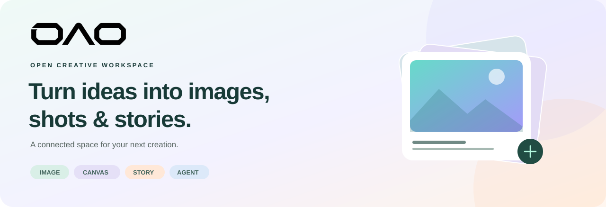

<div align="center">



**把想法变成画面、镜头与故事。**

一个连接 AI 生成、自由画布、创作项目与运营管理的开源工作台。

[](LICENSE)
[](https://nextjs.org/)
[](https://react.dev/)
[](https://www.typescriptlang.org/)

[访问 OAOOAO](https://oao.lunapi.xyz) · [后端文档](backend/README.md) · [部署指南](DEPLOYMENT.md) · [反馈问题](https://github.com/buyue666/OAOOAO/issues)

</div>

---

## 从灵感到作品

不必在一组互不相通的生成工具之间搬运素材。OAOOAO 将描述、参考、生成结果与镜头组织在同一套创作流程里：先探索一张图，再把它接入画布，或发展成一个持续迭代的项目。

| 创作空间 | 可以做什么 |
| --- | --- |
| **图片与视频** | 输入描述、上传参考、选择已配置模型，查看费用、任务进度与生成记录，再复用结果。 |
| **自由画布** | 连接素材与生成节点，使用小地图、整理布局、编组、撤销重做与版本化保存；将节点交给创作助手。 |
| **3D 导演台** | 在画布中添加独立导演节点，摆放白盒角色与机位，切换画幅、网格和基础姿态，导出预演截图并继续交给生成流程。 |
| **镜头项目** | 管理创作提纲、分集、主体参考与镜头候选，采用满意版本，组织视频与交付文件。 |
| **创作助手** | 携带当前项目或画布上下文规划步骤，确认费用后执行，跟踪任务并将结果写回创作空间。 |
| **技能与资产** | 保存可复用的提示词指令，选择技能参与生成，管理图片、视频、音频及历史素材。 |
| **账户与运营** | 套餐、独立积分超市、签到规则、积分流水、订单、公告横幅和弹窗、品牌与页脚配置。 |

### 让规则和使用体验保持一致

- **按身份签到**：普通用户与有效套餐可以分别设置赠送数量、永久或限时有效期；领取结果记录当时规则，之后调整配置不追溯修改已领积分。
- **看得懂的积分**：区分永久、每日与限时积分，展示有效期和流水；生成扣费、退款与到期处理由后端事务执行。
- **可配置的品牌**：前台与管理后台共享站点品牌，公告支持颜色、动效、跳转和预览；页脚固定提供开源入口。
- **导出偏好**：用户可以在了解说明后设置 AI 显式水印偏好；实际导出仍取决于媒体类型与服务端支持。

> 当前技能是可复用的文本指令，不是任意代码插件。生成能力取决于已实现的模型适配器与实际渠道配置；没有可用模型时，界面会明确提示。

3D 导演台根据公开的导演台交互模型独立实现，没有复制外部项目的源代码或素材。相关 MIT 来源与版本记录见 [`THIRD_PARTY_NOTICES.md`](THIRD_PARTY_NOTICES.md)；内置白盒几何体不依赖外部模型、贴图或全景资源。

## 前后端

| 目录 | 职责 | 技术 |
| --- | --- | --- |
| 仓库根目录 | 创作界面、管理后台、同源 API 代理 | Next.js · React · TypeScript · React Flow |
| [backend/](backend/README.md) | 账户、钱包、订单、任务、素材与项目持久化 | Node.js · Fastify · PostgreSQL · FFmpeg |

```text
浏览器 ──→ OAOOAO / Next.js ──→ 独立后端 / Fastify
                  同源 API              ├─ PostgreSQL：账户、积分、任务、项目
                                        ├─ 持久化媒体目录
                                        └─ 配置好的模型与邮件服务
```

前后端源码位于同一仓库，由同一个提交标识完整版本。根目录使用 pnpm 管理前端，`backend/` 使用自己的 `package-lock.json` 和 npm；两者分别安装、构建并运行。渠道密钥由后端保存和使用，不放入浏览器环境变量。

## 本地运行

需要 **Node.js 22+**、**pnpm 12.3.4** 和 npm。克隆一次仓库，在根目录安装前端依赖：

```sh
git clone https://github.com/buyue666/OAOOAO.git
cd OAOOAO
pnpm install --frozen-lockfile
```

再按[后端快速开始](backend/README.md#快速开始)准备 PostgreSQL。在另一个终端进入 `backend/`，用 `npm ci` 安装后端依赖，配置 `backend/.env`、迁移数据库并启动服务；根目录的 pnpm 命令只处理前端。

将根目录的 `.env.example` 复制为 `.env.local`，填入本地地址：

```dotenv
OAOAO_BACKEND_URL=http://127.0.0.1:3001
OAOAO_PUBLIC_URL=http://localhost:3000
```

```sh
pnpm dev
```

打开 `http://localhost:3000`。后端的 `PUBLIC_ORIGIN` 应匹配浏览器访问源；`ALLOWED_ORIGINS` 还应包含前端代理使用的精确后端地址。生产环境的 HTTPS、Cookie、代理信任和环境变量说明见[部署指南](DEPLOYMENT.md)。

## 管理与配置

首次管理员通过后端显式初始化命令创建，仓库不附带默认管理员密码。

| 配置入口 | 内容 |
| --- | --- |
| 系统设置 → 站点与品牌 | 品牌图标、名称、页脚、独立服务条款与隐私政策。 |
| 系统设置 → 注册与积分 | 注册策略、签到开关、普通用户及各套餐的签到积分和有效期。 |
| 系统设置 → 运营与支付 | 运营模式、购买政策、人工收款与易支付配置。 |
| 系统设置 → 微信登录 | 公众号扫码登录、回调配置与注册策略；已有用户在账户设置中绑定微信。 |
| 系统设置 → 计费与权益 | 通过中文多选设置允许的创作功能，配置每日额度和默认权益。 |
| 商品与套餐 | 套餐权益、展示颜色、价格与单独出售的积分包。 |
| 模型与渠道 | 实际模型、渠道绑定、计费与可用能力。 |
| 内容与公告 | 顶部横幅、文字或图片弹窗、跳转链接、展示时段及预览。 |

**配置商品不等于启用收款。** 易支付支持 MD5 与 RSA 协议的提交、签名验证和幂等到账；支付宝、微信可通过已配置的易支付平台收款。退款需要先在本站预留积分，再在原收款渠道办理并核实，最后在本站确认登记；本站不会自动转出退款资金。

微信公众号扫码登录需要具备参数二维码接口权限的公众号及有效回调配置。已有用户须先通过密码登录并绑定微信，避免生成第二个账户；开启邮箱验证注册时，未绑定用户需先注册并验证邮箱。支付与微信都需要实际商户或公众号完成联调，测试替身不能代替正式验收。

MFA、支付宝/微信支付/Stripe 的直接支付协议、创作对象存储写入、自动邀请风控、任意可执行技能和剪映官方格式导出尚未实现。管理后台「上线检查」会显示这些边界，详见[功能核对记录](docs/INTEGRATION-AUDIT-2026-10-14.md)。

## 开发与验证

```sh
pnpm exec tsc --noEmit --pretty false
pnpm test:acceptance
pnpm build
```

后端验证在 `backend/` 中分别运行 `npm run typecheck`、`npm run build` 和 `npm test`；运行集成测试前按[后端验证说明](backend/README.md#验证)配置专用测试数据库。

验收测试覆盖主要状态、权限、交互与接口契约；后端另有使用临时 PostgreSQL schema 的集成测试。真实模型消费、邮件投递与实际收退款需要在已配置的隔离环境单独验收。请不要把测试脚本指向生产数据库或真实客户账号。

```text
app/                   页面路由与同源 API 代理
components/studio/     创作工作台与管理界面
components/studio/    创作工具、画布编辑器与管理后台
lib/studio/            数据契约、客户端状态与业务工具
public/media/brand/    OAOOAO 品牌资源
tests/                 回归与验收测试
docs/                  设计记录与验收范围
backend/               Fastify 后端、SQL 迁移、独立 npm 锁文件与后端文档
```

欢迎提交问题与改进。提交时说明复现步骤、预期结果和验证方式；请移除密钥、会话、数据库导出和用户素材。安全问题请发送至 **siyuesy@gmail.com**，不要在公开 Issue 中附带凭据。

## 开源许可

OAOOAO 前端与独立后端采用 **GNU Affero General Public License v3.0**（`AGPL-3.0-only`）。完整条文见 [LICENSE](LICENSE)。

可以按许可证使用、修改和分发，包括商业用途；对修改版本提供网络服务时，应按 AGPL 第 13 条向交互用户提供该版本的对应源码。保留许可证、版权与第三方声明；部署时应让页脚的源码入口能找到实际运行版本及其前后端源码。

第三方材料仍适用各自许可证，详见 [THIRD_PARTY_NOTICES.md](THIRD_PARTY_NOTICES.md) 及[完整前端依赖声明](THIRD_PARTY_DEPENDENCY_NOTICES.txt)。仓库许可不授予第三方商标、用户素材或外部模型服务的使用权。后端的实现来源与历史审查边界记录在 [backend/README.md](backend/README.md#来源与许可)；当前来源核对及整改范围见[来源复核记录](docs/SOURCE-REVIEW-2026-10-14.md)。

<div align="center">

**OAOOAO · 为下一次灵感，留一片自由的空间。**

</div>
